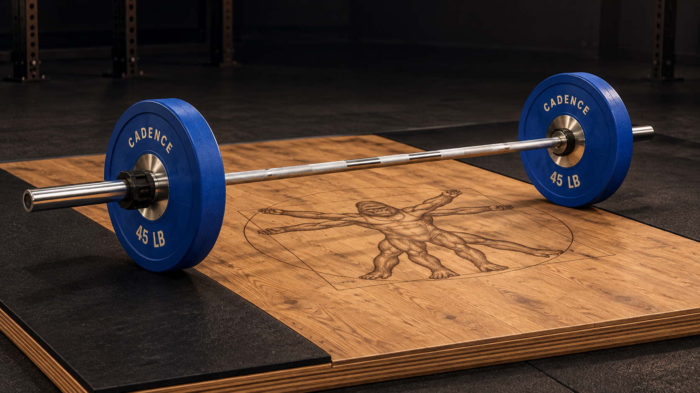

# Astra visual references — 1 November 2026

The owner asked Codex to bring this downloaded concept set into Cadence and
assist Claude with visual design while Claude continues the feature and watch
work. The 16 supplied files are preserved byte-for-byte, including the original
README, prompts, image manifest and gorilla reference. This directory is the
shared visual handoff; it adds no runtime assets or application behavior.

**Recommended direction:** blue bumpers on honey oak, the original Vitruvian
gorilla integrated into the wood, a quiet charcoal surround, large chalk load
figures and restrained oxide-red actions. These are recommendations for review;
importing the pack does not select an icon or approve a renderer replacement.

## Reference map

| Reference | What to carry into the app |
| --- | --- |
| [01 — Plate loading](01-screen-plate-loading.png) | Achieved load first, readable unit conversion, substantial equipment stage, reachable use-load action. |
| [02 — Active session](02-screen-active-session.png) | Lift → set progress → load × reps → equipment → Done. Secondary details stay quiet. |
| [03 — Oak / blue bumpers](03-platform-oak-blue.png) | Primary material and lighting reference: warm wood, saturated matte rubber, bright chrome. |
| [04 — Walnut / calibrated](04-platform-walnut-calibrated.png) | Thin steel plates and darker wood remain visibly different from rubber bumpers. |
| [05 — White oak / black bumpers](05-platform-white-oak-black.png) | Black rubber has edge definition and surface detail without becoming glossy plastic. |
| [06 — Oak / iron](06-platform-oak-iron.png) | Rough cast iron, raised lettering, distinct rim and restrained wear. |
| [07 — Maple / yellow bumpers](07-platform-maple-yellow.png) | Lighter timber and yellow rubber study; preserve the actual theme's denominations. |
| [08 — Overhead](08-platform-overhead.png) | Platform layout and logo placement; both stacks sit on rubber drop zones. |
| [09 — Heritage](09-icon-heritage-master.png) | Full-figure parchment composition. |
| [10 — Foundry](10-icon-foundry-master.png) | Full figure in chalk on charcoal with an oxide ring. |
| [11 — Focus](11-icon-focus-master.png) | Recommended small-icon composition to evaluate: face and shoulders remain legible. |
| [12 — iPhone / Watch comparison](12-icons-iphone-watch-comparison.png) | Composition comparison only; actual size/mask proof still belongs in the native pipeline. |

See [the supplied notes](READ-ME.txt), [image hashes and dimensions](image-manifest.json),
[generation prompts](prompts.json) and [unchanged source reference](reference/original-gorilla.png).
The earlier [approved references](../approved/README.md) remain useful for the
other app surfaces.

## Collaboration with the active implementation

Codex supplies visual direction, imagery and visual critique. Claude continues
feature integration, native layout and watch implementation in the existing
PRs. Coordinate a concrete asset contract before either side changes the
renderer technique. These references should help the current work converge.

| Existing work | Handoff |
| --- | --- |
| [Renderer #374](https://github.com/madhakish/cadence/pull/374) | Use 03 for lighting/materials and 01–02 for framing. Keep row, stage and inspector coherent and driven by the actual `PlateSolution`. |
| [Icons #377](https://github.com/madhakish/cadence/pull/377) | Evaluate Focus through the existing source-preserving icon workflow. The owner still chooses the final treatment. |
| [Session #376](https://github.com/madhakish/cadence/pull/376) | Use 02 for hierarchy and visual weight while keeping independent set editing and existing session semantics. |
| [Theme #375](https://github.com/madhakish/cadence/pull/375) | Carry the charcoal/chalk/oxide relationship and condensed figure hierarchy into native tokens. |
| [Today #378](https://github.com/madhakish/cadence/pull/378) | Give the relevant loaded equipment room in the hero; gym tag and Start/Resume remain easy to reach. |
| [Watch #373](https://github.com/madhakish/cadence/pull/373) | Translate typography, contrast and action priority to the small screen. Keep the current set, rest and action immediately readable. |

## What makes the imagery convincing

The gap between a diagram and these references is material response, lighting
and composition. Chrome needs coherent narrow reflections and fine knurl on
the shaft, with smooth sleeves. Rubber needs molded edges and a quiet satin
surface; iron needs roughness and raised lettering. Wood grain should continue
through the logo burn. Contact shadows must ground the plates on the rubber.
Keep the gym background subdued and keep essential UI text on a readable field.

Use the canonical gorilla artwork for production material/decal transforms and
source-preserving icon derivation. Generated redraws can change anatomy,
lettering and hardware. The complete figure suits the platform; the face crop
is a stronger candidate for tiny icons.

These are generated design concepts, not app screenshots, a component asset
kit or a 3D model. Do not install an entire screen image as functioning UI or
use one fixed bar image for every load. Real labels, denominations, stack order,
collars and geometry must come from the app's equipment tables and solver.
The pound bumper row in 01 is not an IWF kilogram color guide. The screen
concepts' navigation and example copy do not redefine the shipped app flow.

The three icon masters are opaque 1254 × 1254 PNGs. Export through the existing
icon pipeline and verify the system masks and small sizes before installation.

## Native visual acceptance

1. Compare actual iPhone captures with 01 and 02 at matching synthetic loads:
   135 lb = 45 lb bar + one 45 lb plate per side; 225 lb = 45 lb bar + two per
   side. Training collars in these examples add no competition-collar mass.
2. Check the equipment stage, row and inspector for consistent materials,
   visible denominations, correct far-side hardware and believable contact.
   Include rubber, calibrated steel and iron themes rather than blue alone.
3. Capture ordinary and accessibility text sizes. Keep load, units, independent
   set controls and the primary action readable and reachable with safe areas,
   VoiceOver and reduced motion respected.
4. Inspect actual iPhone and Watch icon renditions, including the small watch
   launcher and supported appearances. The comparison board alone is no proof.
5. Record the tested commit and actual native captures in the implementation
   PR. Evaluate render latency and memory on the chosen approach. A concept
   import does not establish native visual or performance acceptance.
