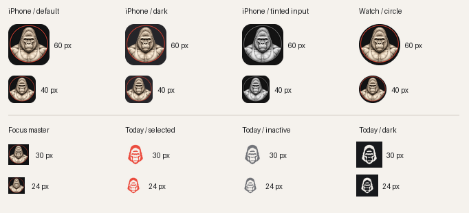

# Astra Focus on the native launchers and Today tab



The 1024 px opaque iPhone and Watch icons are identical to the Focus export reviewed in #387. The source is the [Focus master](../astra-2026-11-01/11-icon-focus-master.png) from #385. Its SHA-256 is `05cd5901ff65939deb490dd3c1f354877b70d916184cd954eb3d2cd52987f632`. The default icon SHA-256 is `2f46d91e16241afc796395222192fb7e8b675e086d770c39c550429002e7eed7`.

The iPhone dark rendition opens the charcoal field to the system background while keeping ink inside the engraving opaque. The tinted rendition supplies the original composition in grayscale. Watch uses the opaque square master and applies its circular mask. The figure and oxide ring fit inside the circle. [Apple’s asset catalog guidance](https://developer.apple.com/documentation/xcode/configuring-your-app-icon)

Today uses a single-color 30 pt template. Its silhouette follows the head and jaw. The brow, nose, cheek shadows and mouth come from the Focus engraving with fine hatching suppressed. The highlights on the eyelids are widened for the single-density rendition. The second row compares this stencil with the full artwork at the same 24 and 30 pixel sizes. These scale studies use illustrative masks and tints. The two native tab tests also capture the selected tab, the inactive tab, and maximum Dynamic Type in the app.

To regenerate the assets and the scale sheet with Python and Pillow 13.0.0, run the following from the repository root.

```sh
python3 docs/design-pass/astra-focus/render.py --proof-dir docs/design-pass/astra-focus
```

The visual-proof workflow runs `test24TodayTabReturnsToLiveWorkout` and `test25TabBarAtAccessibilityTextSize` at 375 and 430 pt. The selection of Focus is proposed for owner review.
