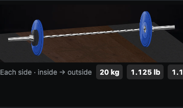
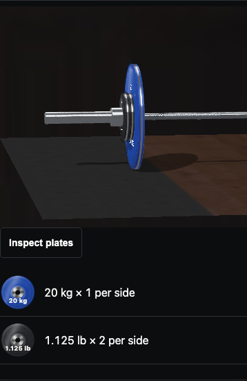
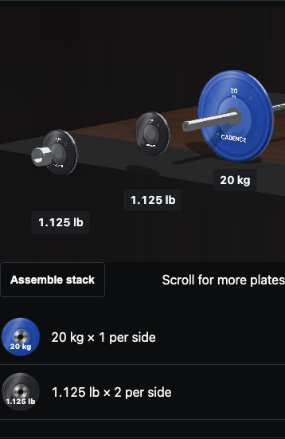
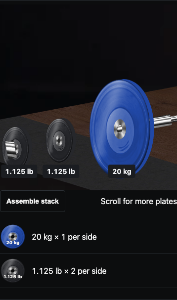

# Astra equipment in the PWA

Workout previews, session rows, exercise details and both calculator modes share the SVG projection of the solved rack. The physical disc determines its front radius, depth, side and stack index. The image supplies its surface. A captured set’s load basis controls whether an exercise gets a bar, a dumbbell or a text-only prescription.

The inspector switches to the WebGL near sleeve for its assembled and exploded cameras. The stage projects a finite 8 ft platform, catches the bar’s shadow and samples the Astra room for the backdrop and metal reflections. Losing the GPU switches the current pose to the SVG. The service worker includes every image on first install.

| Runtime surface | Source in the native asset catalog |
| --- | --- |
| Plate face, insert and badges | Seven unlettered AstraPlate faces share a centered 73 px outer radius and a separate hub. Their registered photos come from Astra masters 03–06. The renderer applies the chosen theme and writes the stored denomination. The five exact colored pound bumpers have separate, preprinted images from master 01. |
| Knurled bar and chrome | AstraSleeve is a rectified strip of the exposed sleeve in 03. WebGL uses AstraChromeRoughness to vary reflection roughness on modeled chrome and preserves the modeled knurl. |
| Room and platform | AstraStudioRoom uses clear background from 03. Each platform export uses the corresponding native panel, the 08 mat and a single 950 mm Heritage engraving from 09. Calibrated steel uses walnut, black banded bumpers use white oak, IWF training uses maple and the remaining gyms use oak. |
| Category and dumbbell | The Main category uses the phone crop of 07. The unnumbered AstraDumbbell accompanies the per-implement load in the selected unit. These pictures appear only in their respective contexts. |

From the repository root, run `python3 web/tools/export-astra-equipment.py` with Pillow and NumPy to regenerate the runtime images. `node web/tests/astra-equipment.test.mjs` compares straight copies byte for byte and exercises every theme in both units. From `web`, run `npx playwright test tests/browser/astra-equipment.spec.mjs` to install the real worker, disconnect the origin, view a mixed kg/custom-lb stack, and test live context loss. The Chromium captures below use a 45 lb bar with one 20 kg and two 1.125 lb plates per side, plus collars.

| Inline | Live assembled | Live exploded | SVG after GPU loss |
| --- | --- | --- | --- |
|  |  |  |  |
