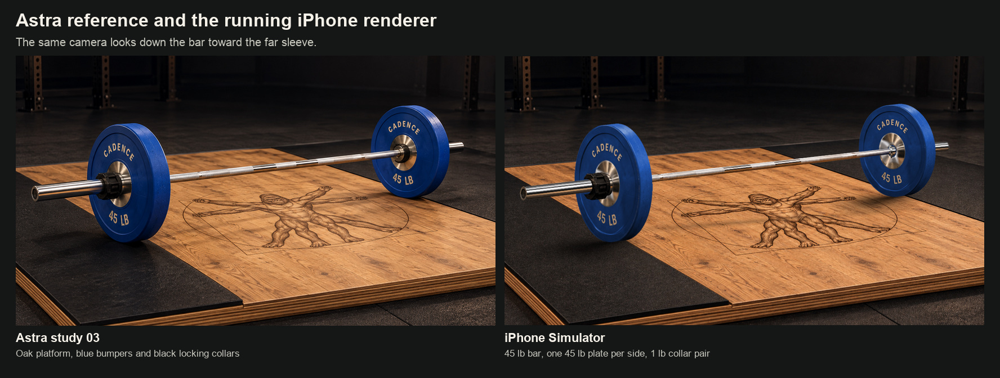

# Photographic equipment



The [Astra oak and blue bumper study](../astra-2026-11-01/03-platform-oak-blue.png) sets the camera, materials and lighting. The four empty platforms keep the wood, rubber, rack and engraving in the same perspective. The bar, plates and clamps are drawn separately. Adding a second 45 lb plate widens both stacks. Switching from 45 lb to 20 kg changes the stamped face. A plate beyond the end of an exploded sleeve shows the gym through its open bore.

## Source and composition

Studies 03–07 supply the original blue rubber face and tread, black rubber, lacquer, iron wear, chrome shaft and endcap, engraved lettering and closed clamp. The eight [isolated product masters](masters) supply clean material where the equipment in the original photographs overlaps, including dedicated hammertone and lathe-turned steel. The built-in ImageGen edits and their reference instructions are recorded in [prompts.json](prompts.json).

The native and web compositors use the same PNGs and registered stage JPEGs. They read the ordered plate records, real bar dimensions and collar configuration. The stamped marks for 45 lb, 20 kg and 15 kg come from the studies. Other weights, including custom fractions, are printed from the actual value and unit. The plate guide, rack inventory, set markers, assembled bar and exploded sleeve use the same product art. [Web equipment notes](../astra-native-ui/WEB-EQUIPMENT.md)

## Simulator and browser captures

The iPhone 18 Pro simulator on iOS 27.2 produced 22 native equipment captures. The comparison above shows a 45 lb bar with one 45 lb bumper per side and a configured 1 lb pair of collars. The bare 135 lb configuration omits the clamps. The rubber on the iPhone reads slightly brighter than the reference under the rim highlight. [Original collared capture](proof/iphone-one-pair-with-collars.png)

The [dynamic load comparison](proof/dynamic-loads.jpg) shows an empty bar, a 225 lb stack and the 138.7 lb mixed load, both assembled and exploded. The [equipment matrix](proof/equipment-matrix.jpg) covers the eleven themes, compact presentation and long stacks. [Original 225 lb](proof/iphone-225-lb.png) · [Original mixed assembly](proof/iphone-mixed-assembled.png) · [Original exploded sleeve](proof/iphone-mixed-exploded.png) · [Native source and original PNG hashes](proof/provenance.json)

The PWA uses the same photographs in the actual [plate calculator](proof/web-calculator.png) and [exploded mixed-unit inspector](proof/web-mixed-exploded.png), including after an offline reload.

## Reproducing the artwork

From the repository root with Pillow and NumPy installed, run the exporter check. Copy the native assets to the PWA after changing the art.

```sh
python3 docs/design-pass/photographic-equipment/export_parts.py --check
python3 web/tools/export-astra-equipment.py
```

The iPhone visual-proof workflow runs the production renderer on the simulator and exports the PNGs. With the web development dependencies installed, this compares the near and far bumper silhouettes against the source and checks that adding a second plate visibly widens the stack.

```sh
node web/tools/check-native-bumper-capture.mjs /path/to/studio-renders
```
